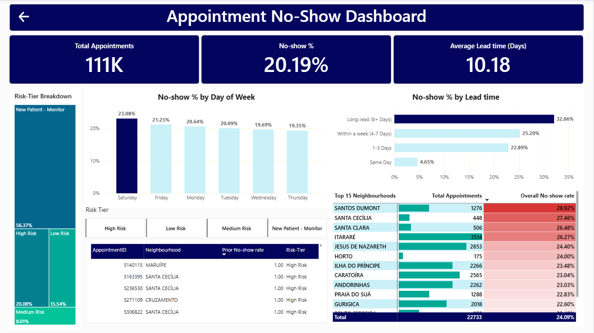

# Medical Appointment No-Show Analysis

## Project Background

Missed medical appointments can disrupt scheduling and leave healthcare capacity unused. This project analyzes appointment records from Brazil to describe patterns associated with no-shows and explore how historical attendance and appointment lead time can support appointment-level risk segmentation.

The analysis uses SQL for data preparation and investigation and Power BI to present selected findings in an interactive dashboard.

The analysis focuses on four areas:

- **Scheduling:** How no-show rates vary by appointment lead time and weekday.
- **Patient segments:** How rates vary by age group and rule-based risk tier.
- **SMS and lead time:** How the aggregate reminder comparison changes within lead-time groups.
- **Neighbourhood:** Where appointment volume and observed no-show rates are comparatively high.

The SQL queries used to inspect and clean the data for this analysis can be found here [link].
An interactive Tableau dashboard used to report and explore sales trends can be found here [link].

## Data Structure & Initial Checks

The source contains **110,527 appointment records**. After cleaning, the analysis set contains **110,521 records**, a reduction of **6**. The appointment-level fields include patient and appointment identifiers, scheduled and appointment dates, age, gender, neighbourhood, health indicators, scholarship status, SMS reminder status, and attendance outcome.

Cleaning and preparation included **reviewing field names and types**, **standardizing column names**, **investigating an invalid age and negative lead times**, and **calculating lead time** from the scheduled and appointment dates. The **six-record difference** between the original (110,527) and cleaned (110,521) counts is shown throughout this README.

## Executive Summary

The cleaned dataset has an overall no-show rate of **20.19%** and an average lead time of **10.18 days**. The highest observed lead-time rate was **32.06%** for appointments booked 8 or more days ahead; the same-day rate was **4.65%**. Saturday had the highest no-show rate among the weekdays displayed (**23.08%**), and the Teen age group had the highest rate among the supplied age groups (**25.95%**).

The aggregate SMS comparison was **27.57%** for appointments with an SMS recorded and **16.70%** for those without one. Within each displayed lead-time group that has both reminder statuses, the SMS group had a lower observed rate. This suggests that lead-time mix may contribute to the aggregate difference, but the analysis is observational and does not show that SMS reminders cause attendance outcomes.

The dashboard provides an interactive overview of medical appointment no-show patterns, including key performance indicators, no-show rates by weekday and lead time, neighbourhood comparisons, and patient risk-tier analysis.

## Insights Deep Dive

### 1. Scheduling patterns

**No-show rate by lead time**

| Time between scheduling and appointment | No-show rate |
|---|---:|
| 8+ days | 32.06% |
| 4–7 days | 25.20% |
| 1–3 days | 22.89% |
| Same day | 4.65% |

Appointments booked further in advance had **higher observed no-show rates**, suggesting that longer lead time may be an important contributor to missed appointments. This pattern points to an opportunity to test whether earlier follow-up or confirmation helps patients keep appointments.

**No-show rate by weekday**

| Day | No-show rate |
|---|---:|
| Saturday | 23.08% |
| Friday | 21.23% |
| Monday | 20.64% |
| Tuesday | 20.09% |
| Wednesday | 19.69% |
| Thursday | 19.35% |

Saturday had the **highest observed no-show rate at 23.08%.** Rates on the other displayed weekdays ranged from **19.35%** to **21.23%**, showing less variation by weekday than by appointment lead time.

### 2. Age groups and risk tiers

**No-show rate by age group**

| Age group | Appointments | No-shows | No-show rate |
|---|---:|---:|---:|
| Teen | 9,374 | 2,433 | 25.95% |
| Young Adults | 28,868 | 6,678 | 23.13% |
| Child | 21,035 | 4,306 | 20.47% |
| Adults | 30,072 | 5,656 | 18.81% |
| Seniors | 21,172 | 3,241 | 15.31% |

No-show rates were **higher among younger patients: 25.95% for Teens and 23.13% for Young Adults, compared with 15.31% for Seniors.** The clinic could review whether appointment times and rescheduling options work for younger patients, then track no-show rates to see whether more flexible scheduling improves attendance.

**Risk-tier distribution**

| Rule-based tier | Share of appointments |
|---|---:|
| High Risk | 20.08% |
| Medium Risk | 8.01% |
| Low Risk | 15.54% |
| New Patient – Monitor | 56.37% |

**More than half of appointments (56.37%)** were assigned to **New Patient–Monitor**, while **20.08% were classified as High Risk.** These tiers can help the clinic see where appointments are concentrated and prioritize which groups to review for follow-up planning.

### 3. SMS reminders and lead time (SQL analysis)

Across all appointments, the observed no-show rate was **27.57%** (**9,784 of 35,482**) when an SMS was recorded and **16.70%** (**12,530 of 75,039**) when no SMS was recorded. This aggregate comparison does not account for differences in appointment lead time.

| Lead-time group | Reminder status | Appointments | No-shows | No-show rate |
|---|---|---:|---:|---:|
| Long lead (8+ days) | No SMS received | 15,840 | 5,710 | 36.05% |
| Long lead (8+ days) | SMS received | 23,934 | 7,040 | 29.41% |
| Within a week (4–7 days) | No SMS received | 6,868 | 1,862 | 27.11% |
| Within a week (4–7 days) | SMS received | 10,642 | 2,551 | 23.97% |
| 1–3 days | No SMS received | 13,769 | 3,166 | 22.99% |
| 1–3 days | SMS received | 906 | 193 | 21.30% |
| Same day | No SMS received | 38,562 | 1,792 | 4.65% |

The displayed cross-tabulation totals **110,521 appointments**, matching the cleaned dataset. Overall, appointments with an SMS recorded had a higher no-show rate than those without one. However, within each lead-time group where both SMS statuses were available, appointments with an SMS had lower no-show rates. This difference may be partly related to the SMS group having more appointments booked well in advance, when no-show rates were already higher.

**Scope:** This SMS and lead-time analysis was performed in SQL and is not included in the Power BI dashboard.

### 4. Neighbourhood results

The highest-ranked neighbourhood in the supplied results was **Santos Dumont**, with **1,276 appointments** and a **28.92%** no-show rate. Neighbourhood rates should be considered alongside appointment volumes. The SQL ranking applied a minimum appointment-count threshold to limit the influence of very small groups.

## Power BI Dashboard

The dashboard presents selected attendance findings and supports interactive exploration with:

- KPI cards for total appointments, overall no-show rate, and average lead time
- No-show rate by weekday and lead-time segment
- Risk-tier breakdown and a risk-tier slicer
- Top 15 neighbourhoods by no-show rate, with appointment counts
- A patient appointment risk table with historical no-show information and assigned risk tiers
- Conditional formatting to emphasize values and patterns

SMS reminder comparisons are reported in the SQL analysis above and are not part of the dashboard.

## Tools & Project Deliverables

- **SQL (MySQL):** Data cleaning, transformations, grouped analysis, CTEs, window functions, and rule-based risk classification
- **Power BI:** Data modeling, DAX measures, interactive visuals, slicers, conditional formatting, and dashboard development
- **Excel / CSV:** Dataset handling and transfer between tools

Project deliverables include the SQL data preparation and analysis, the cleaned appointment analysis set and risk classification, the interactive Power BI dashboard, and this README.

## Assumptions & Caveats

- The original dataset contains **110,527** records; the cleaned analysis uses **110,521**. Six records were removed during cleaning.
- The analysis is descriptive. Observed relationships do not establish cause and effect.
- SMS status may be associated with other appointment characteristics, including lead time. The comparisons do not prove reminder effectiveness.
- The risk tiers are rule-based analytical categories, not validated clinical predictions or a machine-learning model.
- Group-level rates should not be treated as explanations of an individual patient's behavior or as a basis for restricting care.

**Author:** Naveen Sharma

